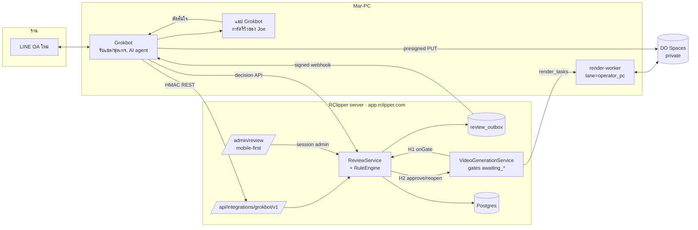
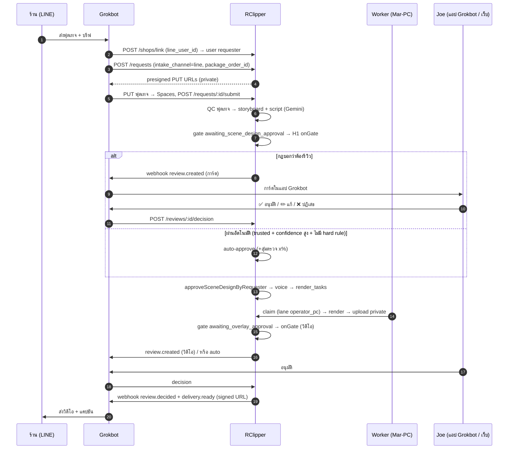
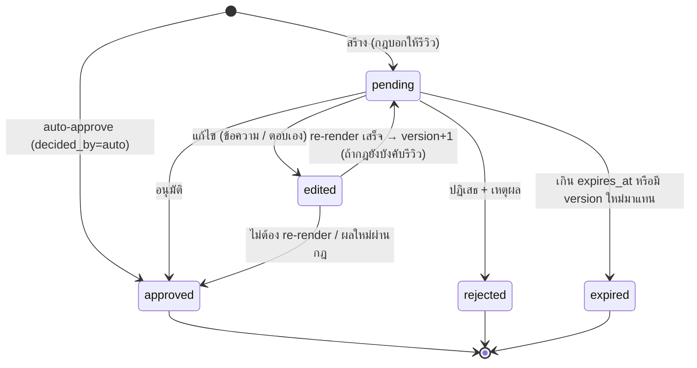
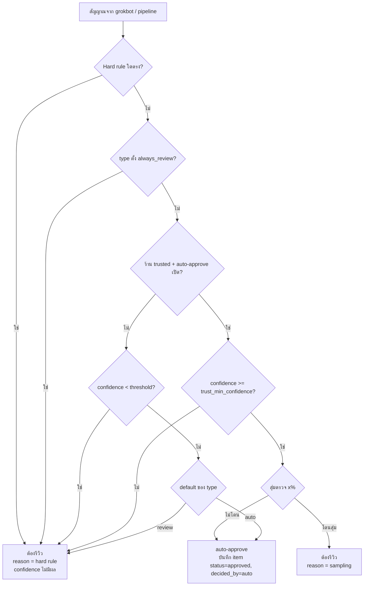

# RClipper — Admin Review System (DESIGN)

> สถานะ: ออกแบบ (ยังไม่มีโค้ด) · เขียน 31 ต.ค. 2026 · repo `D:\coding\clipper_agent`
> เอกสารชุดนี้: `DESIGN.md` · `SCHEMA.sql` · `API.md` · `NOTIFICATION_TEMPLATES.md` · `UI_WIREFRAME.md` · `IMPLEMENTATION_PLAN.md`

---

## 0. การตัดสินใจที่ยืนยันกับ Joe แล้ว (31 ต.ค.)

| เรื่อง | ข้อสรุป |
|---|---|
| ช่องทางร้าน | ร้านคุยกับ grokbot ผ่าน **LINE Official Account ตัวใหม่** และส่งฟุตเทจดิบเข้ามาทางนั้น |
| ช่องทางแจ้ง admin | grokbot แจ้ง Joe **ภายในแอป Grokbot** (RClipper ไม่ส่งข้อความหา Joe ตรง ๆ แต่ยิงผ่าน adapter) |
| โค้ด grokbot | อยู่อีก repo ชุดนี้ออกแบบเฉพาะฝั่ง RClipper (API, webhook, ข้อมูล และหน้าเว็บ) |
| บัญชีร้าน | ร้าน LINE ต้อง **สร้างหรือผูกกับ user ที่มี role `requester`** (ใช้ `users` + `business_profiles` เดิม) |
| แพ็กเกจ | **RClipper เป็นผู้เก็บและนับ** แพ็กเกจบริการ เช่น 2 คลิป 200–500 บาท พร้อมจำนวนครั้งที่แก้ได้ |
| สลิป | **ไม่ทำ** (ตัด review type "สลิปตรวจไม่ผ่าน" ออก) |
| ที่ render | **Mar-PC** (เครื่องเดียวกับที่รัน Grokbot) รัน `scripts/render-worker.ts` เป็น lane `operator_pc` · มือถือ Android ต่อ PC เป็นตัวเลือกสำรองผ่าน adapter เดียวกัน (§9.3) |

## 1. สิ่งที่พบใน codebase (ขั้นตอนที่ 1)

**Stack.** Next.js 14 App Router + TypeScript + Tailwind, NextAuth v4 (credentials / Google / Apple native), PostgreSQL ผ่าน `pg` (`src/lib/db.ts`), Zod, jose, DO Spaces (S3 SDK), Capacitor 8 shell (Android/iOS) ที่โหลด `app.rclipper.com`

**โครงสร้าง.** `domain/` (models, enums) → `repositories/` (interfaces / mock / postgres, registry เดียวที่ `src/repositories/index.ts`) → `services/` (business logic) → `app/` (pages + `api/`) · `features/` (UI ตามโดเมน) · `config/` · `lib/` (infra)

**DB.** `src/db/schema.sql` + `migrations/` (ชุดเก่า) + `src/db/migrations/` (ชุดปัจจุบัน 035–047, **เลขถัดไป 048**) apply ด้วย `node scripts/apply-migration.js <file>`
- `users.id` = **UUID**, `clip_requests.id` / `user_id` = **TEXT** (ใช้ปนกันมาตั้งแต่ต้น) ตาราง review จึงอ้าง `request_id TEXT` **โดยไม่ใส่ FK** ตามแนวของ 041 `studio_events`
- ตารางที่เกี่ยวข้อง: `clip_requests` (`render_location` server|device), `uploaded_assets` (`device_local_id`), `video_generation_jobs` (+ `video_generation_step_history`), `render_tasks` (`device_only`, claim แบบ `FOR UPDATE SKIP LOCKED`), `device_render_attempts`, `business_profiles` (`business_name`), `ai_content_reports`, `push_notification_deliveries` (กันส่งซ้ำด้วย unique `(job_id, event_key)`)

**Pipeline วิดีโอ/เสียง.** `VideoGenerationService` (5.5k บรรทัด) เดินตาม `VideoGenerationStep` โดยมี gate `awaiting_*` เป็นจุดหยุดรอคน: `awaiting_scene_design_approval` (storyboard + script) → `generating_voice` → `awaiting_voice_approval` → render → `awaiting_overlay_approval` (วิดีโอหลักพร้อมซับ/look) → `awaiting_additional_ratios` → channels/distribution ทุก gate มีเมธอด `…ByRequester()` อยู่แล้ว (เช่น `approveSceneDesignByRequester`, `approveVoiceConversionByRequester`, `approveOverlayByRequester`, `reopenDeviceProductionByRequester`) ส่วน AI ที่ใช้คือ Gemini (storyboard/script/subtitles), ElevenLabs (TTS) และ Remotion/FFmpeg (render)

**ที่เก็บไฟล์.** `src/lib/spaces.ts`: `spacesUpload()` (**ค่าเริ่มต้น `ACL: "public-read"`**), `spacesSignedUrl(key, ttl)` (presign GET, ค่าเริ่มต้น 1 ชม.) และ prefix ทั้งหมดอยู่ใน `config/mediaPrefixes.json`

**Auth.** `middleware.ts` ใช้ `withAuth` ล็อก `/admin` ให้ role admin, `/dashboard` + `/studio` ให้ requester และใช้ `lib/auth/helpers.ts` (`requireRole`) ส่วน server-to-server ใช้ `api/travy/_guard.ts` (X-API-Key + `timingSafeEqual`) และ webhook post-for-me ใช้ HMAC

**แอดมิน.** หน้าเว็บภาษาอังกฤษ มีเมนูที่ `config/adminNav.ts` และหน้า `/admin/requests/[id]`, `/admin/feedback` มี `ProductionReview` model เดิม แต่ยังเป็น **Mock repo ไม่มีตารางจริง** (staff-era) ระบบใหม่จะไม่ใช้ตัวนี้

### 1.1 จุดต่อ hook (ไม่แก้โค้ดเดิมในขั้นนี้ ระบุไว้สำหรับ phase ถัดไป)

| # | จุด | ทำอะไร |
|---|---|---|
| H1 | ทุก transition เข้า gate `awaiting_*` ใน `VideoGenerationService` (บรรทัดที่ตั้ง `currentStep: Awaiting…` เช่น ~2548, ~2225, ~3741, ~3831) | เรียก `reviewGateHook.onGate(job, step)` **เฉพาะ request ที่ `intake_channel='line'`** ส่วนงาน studio ไม่ถูกแตะ จุดนี้เป็นที่เดียวกับที่ push notice ยิง (`config/push.ts`) จึงควรเพิ่ม hook ข้าง ๆ notice dispatcher ตัวเดียว ไม่กระจายไปทุกบรรทัด |
| H2 | `…ByRequester()` approve/reopen | `ReviewDecisionExecutor` เรียกเมธอดเดิมเหล่านี้เมื่อ admin อนุมัติ/แก้ (กระทำแทนร้าน) ไม่ต้องเขียน logic การเดิน pipeline ใหม่ |
| H3 | `render_tasks` + `PostgresRenderTaskRepository.claimNext` | เพิ่มเงื่อนไข lane (`render_lane`) ให้ worker บน Mar-PC รับเฉพาะงาน LINE และ Mac Mini ไม่เห็นงานนี้ |
| H4 | `spacesUpload` ใน path ของงาน LINE | ส่ง `acl: "private"` ทุกครั้ง (ทั้งฟุตเทจและผลลัพธ์) |
| H5 | `api/travy/_guard.ts` | ใช้เป็นแบบในการสร้าง `api/integrations/grokbot/_guard.ts` (HMAC) |
| H6 | `config/adminNav.ts` | เพิ่มกลุ่ม "Review" (Queue, Rules, Stats) |
| H7 | `middleware.ts` | ไม่ต้องแก้ เพราะ `/admin/review/*` อยู่ใต้ `/admin` และได้ guard อัตโนมัติ |

## 2. ภาพรวมสถาปัตยกรรม



**หลักสำคัญ**
1. **RClipper เป็นแหล่งความจริงของการรีวิว.** สถานะ กฎ log และ SLA อยู่ที่ RClipper ส่วน grokbot เป็น client (เสนอเคส ส่งผลตัดสินจากแอป และรับ webhook) หน้าเว็บกับแอป Grokbot จึงเห็นข้อมูลตรงกันเสมอ
2. **กฎตัดสินฝั่ง RClipper.** grokbot ส่ง "สัญญาณ" (confidence, tags, sentiment, ข้อความลูกค้า) มาให้ RClipper ประเมินกับ `escalation_rules` เราจึงเปลี่ยนกฎได้โดยไม่ต้อง deploy grokbot และ AI ตัดสินใจข้ามกฎเองไม่ได้
3. **ใช้ gate เดิมของ pipeline.** review item ของวิดีโอ/เสียง/ซับเป็น "ร่มเงา" ของ gate `awaiting_*` เมื่ออนุมัติ ระบบจะเรียก `…ByRequester()` ตัวเดิม
4. **ทุกอย่างเป็น async ผ่าน outbox.** การแจ้งเตือนกับ webhook ทุกตัวเขียนลง `review_outbox` ใน transaction เดียวกับการเปลี่ยนสถานะ แล้ว dispatcher ค่อยส่งพร้อม retry ดังนั้นถ้า grokbot ล่มจะไม่มีงานหาย

## 3. Flow หลัก

### 3.1 งานวิดีโอจาก LINE จนถึงส่งกลับร้าน



### 3.2 ข้อความตอบลูกค้า (ไม่เกี่ยวกับ pipeline)

grokbot ร่างคำตอบแล้วถามก่อนว่า "ต้องรีวิวไหม" → `POST /reviews/evaluate` (dry-run) หรือ `POST /reviews` (ให้ RClipper ตัดสินและสร้าง item เอง) ผลที่ได้เป็นอย่างใดอย่างหนึ่ง: `auto_send` (grokbot ส่งได้เลย), `needs_review` (รอ Joe) หรือ `handoff_human` (หยุดบอททันทีแล้วบอกร้านว่าจะมีเจ้าหน้าที่ตอบ)

### 3.3 วงจรสถานะ review item



- สถานะหลักมี 5 ค่าตามที่ขอ: `pending | approved | rejected | edited | expired`
- `edited` มี `render_state` (`none | queued | rendering | done | failed`) อยู่ข้าง ๆ เพราะการแก้ซับ/สคริปต์ต้อง re-render ก่อนส่ง จะได้ไม่ต้องเพิ่มสถานะหลัก
- "ตอบลูกค้าเอง" = `edited` + `resolution='manual_reply'` (grokbot ส่งข้อความที่ Joe พิมพ์ไปตามตัวอักษร)
- `expired` **ไม่ใช่การอนุมัติ** งานที่หมดอายุไม่ถูกส่งให้ร้านเอง (§8)

## 4. ประเภทงานรีวิว (extensible)

ประเภทงานลงทะเบียนในตาราง `review_item_types` (ไม่ใช่ enum ใน DB) และมี handler ในโค้ดที่ `src/services/review/types/<key>.ts` ซึ่ง implement interface เดียวกัน:

```ts
interface ReviewTypeHandler {
  key: string;                       // 'video' | 'tts' | ...
  validatePayload(p: unknown): Payload;          // Zod
  summarize(item): CardSummary;                  // สำหรับการ์ด/คิว
  quickActions(item): QuickAction[];             // ปุ่มที่ตอบในแชตได้
  applyDecision(item, decision): Promise<Effect>;// H2: เรียก pipeline เดิม / ส่งข้อความ
  editableFields?: EditableField[];              // สำหรับแก้ inline
}
```

| key | ชื่อ | ผูกกับ gate | ตอบในแชตได้ | ต้องเปิดเว็บ | applyDecision |
|---|---|---|---|---|---|
| `video` | วิดีโอ (หลัก/สัดส่วนเพิ่ม) | `awaiting_overlay_approval`, `awaiting_additional_ratios` | ✅ อนุมัติ / ❌ ปฏิเสธ (เหตุผลสำเร็จรูป) | แก้ซับ/look, เทียบฟุตเทจ | `approveOverlayByRequester` / `reopenDeviceProductionByRequester` |
| `tts` | เสียงพากย์ | `awaiting_voice_approval` | ✅ / 🔁 ทำเสียงใหม่ | แก้สคริปต์ | `approveVoiceConversionByRequester` / `voice/regenerate` |
| `script` | สคริปต์ + storyboard | `awaiting_scene_design_approval` | ✅ | แก้ข้อความ | `approveSceneDesignByRequester` (ส่ง script ที่แก้) |
| `caption` | ซับ / แคปชันโพสต์ | ซับ: ก่อน render final · แคปชัน: publishing drafts | ✅ | แก้ inline | `edit-subtitle-video` / `savePublishingDraftsByRequester` |
| `customer_reply` | ข้อความตอบลูกค้าที่ไม่แน่ใจ | – | ✅ ส่งตามร่าง / ✏️ พิมพ์ตอบเอง | – | outbox → grokbot ส่ง LINE |
| `out_of_package` | งานนอกแพ็กเกจ | – | ✅ รับ (ระบุราคา) / ❌ ปฏิเสธ | ดูประวัติแพ็กเกจ | สร้าง `package_charges` หรือแจ้งร้าน |
| `complaint` | เรื่องร้องเรียน / ขอคุยกับคน | – | 🙋 รับเรื่องเอง / ✅ ตามร่าง | ดูประวัติแชต | หยุดบอท (handoff) + ส่งคำตอบ |
| `footage_qc` | ฟุตเทจไม่ผ่าน QC | หลัง upload ก่อน storyboard | ✅ ทำต่อ / 📩 ขอฟุตเทจใหม่ | ดูไฟล์ต้นฉบับ | resume / ข้อความขอใหม่ |
| *(ใหม่)* | เพิ่มแถวใน `review_item_types` + handler 1 ไฟล์ | | | | |

> **ตัดออก:** สลิปตรวจไม่ผ่าน (ตามที่ Joe แจ้ง) ถ้าวันหน้าต้องการก็เพิ่มเป็น type ใหม่ได้โดยไม่แก้ schema

**เหตุผล:** ถ้าใช้ enum ใน DB การเพิ่มประเภทใหม่ต้องทำ migration ทุกครั้ง แต่ตาราง + handler registry ทำให้เพิ่มได้ด้วย PR เดียว ส่วน `payload JSONB` ที่ validate ด้วย Zod ต่อ type ก็ยืดหยุ่นพอโดยไม่เสียความปลอดภัยของชนิดข้อมูล

## 5. กฎการส่งเข้ารีวิว (escalation rules)

### 5.1 ลำดับการประเมิน (สำคัญที่สุด)



- **Hard rule ชนะเสมอ** ไม่ว่า confidence จะสูงแค่ไหน และไม่ว่าร้านจะ trusted แค่ไหน (บังคับในโค้ดของ RuleEngine ไม่ใช่แค่ลำดับ priority ใน DB)
- กฎ hard บางข้อเปิด `trust_can_bypass` ได้ทีละกฎ (ค่าเริ่มต้น `false`) เช่น ถ้าภายหลังอยากให้ร้านที่ไว้ใจได้ข้ามกฎ "มีราคา" ได้ ต้องตั้งเองทีละกฎ ส่วนกฎ `wants_human`, `complaint`, `out_of_package` ถูก **ล็อกในโค้ด** ไม่ให้ bypass ได้เลย
- **Auto-approve ก็สร้าง review item** (status `approved`, `decided_by='auto'`) เพื่อให้มี audit trail ครบ ตรวจย้อนหลังได้ และคำนวณอัตราผิดพลาดของ auto ได้

### 5.2 รูปแบบกฎ (เก็บใน `escalation_rules`)

```json
{
  "key": "menu_price_promo",
  "kind": "hard",
  "applies_to": ["video", "script", "caption", "tts"],
  "condition": {
    "any": [
      { "signal": "tags", "op": "contains_any", "value": ["price", "promotion", "menu_name"] },
      { "signal": "text", "op": "regex", "value": "(\\d+\\s*(บาท|฿|THB))|ลด\\s*\\d+%|โปร(โมชั่น)?|ซื้อ\\s*\\d+\\s*แถม" }
    ]
  },
  "reason_th": "คลิปมีชื่อเมนู ราคา หรือโปรโมชัน",
  "priority": 10,
  "enabled": true,
  "trust_can_bypass": false
}
```

- `condition` เป็น DSL เล็ก ๆ (`all` / `any` / `not` + `signal op value`) operator ที่มี: `eq, neq, gt, gte, lt, lte, in, contains_any, regex, exists` ประเมินในโค้ด (pure function, unit-test ได้) **ไม่มี eval** ส่วน regex จำกัดความยาวและตรวจตอนบันทึกกฎ
- `text` signal = ข้อความทุกช่องที่จะไปอยู่ในวิดีโอ/แคปชัน (script, ซับ, แคปชัน, ข้อความตอบ) RClipper รวบรวมเองจาก job ไม่พึ่ง grokbot อย่างเดียว ดังนั้นแม้ AI ไม่ได้ติด tag ว่า "price" regex ก็ยังจับได้ (สองชั้น)
- เก็บ `rule_snapshot` ลง review item ทุกครั้ง แม้แก้กฎภายหลังก็ยังรู้ว่าตอนนั้นส่งมาเพราะอะไร

### 5.3 กฎเริ่มต้น (seed)

| key | kind | เงื่อนไข | หมายเหตุ |
|---|---|---|---|
| `menu_price_promo` | hard | tags price/promotion/menu_name **หรือ** regex ราคา/โปร | ราคาผิดทำให้ร้านเสียเงินจริง |
| `footage_qc_failed` | hard | `qc.passed = false` (มืด สั่น สั้นไป ความละเอียดต่ำ เสียงแตก) | type `footage_qc` |
| `out_of_package` | hard (ล็อก) | RClipper คำนวณ: เกินจำนวนคลิป / เกินจำนวนครั้งแก้ / ขอสิ่งที่ไม่อยู่ในแพ็กเกจ / grokbot flag `request_scope=extra` | type `out_of_package` |
| `customer_unhappy` | hard (ล็อก) | `sentiment <= -0.4` หรือ tags complaint | type `complaint` |
| `wants_human` | hard (ล็อก) | `intent = human_handoff` หรือ regex "ขอคุยกับคน|แอดมิน|เจ้าหน้าที่" | handoff ทันที บอทหยุดตอบ |
| `first_jobs_of_shop` | hard | `shop.completed_jobs < 3` | 3 งานแรกของร้านใหม่รีวิวทุกชิ้น |
| `low_confidence` | threshold | `confidence < 0.80` (แยก threshold ต่อ type ได้) | |
| `sampling` | sampling | สุ่ม `sample_rate` ต่อร้าน/ต่อ type | ใช้กับ auto-approve เท่านั้น |

## 6. Data model (ย่อ ดูรายละเอียดใน `SCHEMA.sql`)

| ตาราง | หน้าที่ |
|---|---|
| `review_item_types` | registry ของประเภทงาน + ค่าเริ่มต้น (SLA, always_review, threshold) |
| `review_items` | 1 เคสรีวิว · สถานะ · payload/draft · เหตุผล · version · เวลา SLA · เวลาที่ใช้รีวิว |
| `review_actions` | log append-only ทุกการกระทำ (created, notified, opened, approved, edited, rejected, reminder, expired, manual_reply…) + diff before/after + `reason_code` สำหรับปรับ prompt |
| `escalation_rules` | กฎที่ตั้งค่าได้ (§5) |
| `review_trust_policies` | auto-approve ต่อร้าน: เปิด/ปิด, sample rate, min confidence, type ที่อนุญาต |
| `review_outbox` | webhook / แจ้งเตือนที่รอส่ง (retry, backoff) |
| `integration_idempotency_keys` | กัน request ซ้ำจาก grokbot (24 ชม.) |
| `line_accounts` | LINE userId ↔ `users.id` (ร้าน) |
| `service_packages`, `package_orders`, `package_usage` | แพ็กเกจที่ RClipper นับ (คลิป, ครั้งแก้) |
| `clip_requests` (+คอลัมน์) | `intake_channel` ('studio' ค่าเริ่มต้น \| 'line'), `package_order_id`, `render_lane` |

**เวลาที่ใช้รีวิว** เก็บ 3 ตัว: `notified_at` (การ์ดถึงแอป), `first_opened_at` (เปิดการ์ด/หน้าเว็บครั้งแรก), `decided_at` แล้วคำนวณ `decision_seconds = decided_at - first_opened_at` (เวลาตัดสินจริง เป้า ≤ 30 วิ) กับ `wait_seconds = first_opened_at - created_at` (เวลารอคน) แยกกัน เพราะสองค่านี้แก้ด้วยวิธีที่ต่างกัน

**เหตุผลที่แก้ (สำหรับปรับ prompt)** `review_actions.reason_code` เป็น taxonomy คงที่ เช่น `wrong_price`, `wrong_menu_name`, `tone_too_salesy`, `thai_spelling`, `caption_too_long`, `wrong_shot_order`, `voice_mispronounce`, `off_brand`, `hallucinated_claim`, `other` พร้อม `reason_text` และ `diff` (JSON) view `review_feedback_export` รวม before/after + prompt_version + model สำหรับ export ไปปรับ prompt หรือทำ few-shot

## 7. หน้าเว็บรีวิว (ดู `UI_WIREFRAME.md`)

- `/admin/review` (queue): เรียงตาม SLA ที่ใกล้หมดก่อน, filter ตาม type/ร้าน/สถานะ, ปุ่มอนุมัติเร็วในการ์ด
- `/admin/review/[id]` (เคสเดียว): preview วิดีโอ/เสียง, ฟุตเทจต้นฉบับ, ร่างของ AI, เหตุผลที่ส่งมา (chip ของกฎ), แถบปุ่มติดล่างจอ **อนุมัติ / แก้ไข / ปฏิเสธ+เหตุผล / ตอบลูกค้าเอง**, timeline ของ action
- `/admin/review/rules`, `/admin/review/trust`, `/admin/review/stats` (เวลาเฉลี่ย, % แก้, top reason_code, ความแม่นของ auto)
- UI ภาษาอังกฤษตามธรรมเนียม admin เดิม (`adminNav.ts` ไม่มี i18n) **ยกเว้นข้อความที่จะไปถึงร้าน** ซึ่งแสดงเป็นภาษาไทยตามที่ส่งจริง (*เปลี่ยนเป็นไทยทั้งหมดได้ถ้า Joe ต้องการ ดู §12*)

## 8. Timeout / SLA

ต่อ type (`review_item_types.sla_minutes`, override ต่อ item ได้):

| ตัวจับเวลา | ค่าเริ่มต้น | ผล |
|---|---|---|
| `remind_after` | 30 นาที แล้วทุก 2 ชม. (สูงสุด 5 ครั้ง; ไม่เตือน 23:00–07:00 ICT ยกเว้น `complaint`/`wants_human`) | outbox `review.reminder` → การ์ดเตือนในแอป Grokbot |
| `customer_notice_after` (X) | 15 นาที (complaint 5 นาที) | outbox `shop.notice_in_review` → grokbot ส่งร้าน "กำลังตรวจงาน คาดว่าจะส่งภายใน {eta}" **ครั้งเดียวต่อ item** |
| `eta` ที่บอกร้าน | `created_at + 24 ชม.` ปัดขึ้นเป็นช่วงเวลาที่อ่านง่าย ("พรุ่งนี้ก่อน 14:00 น.") | ตรงกับที่ Joe รีวิวภายใน 24 ชม. ตามปกติ |
| `due_at` | 24 ชม. | เลยกำหนด: การ์ดเปลี่ยนเป็นสีแดง + เตือนด่วน + ส่งร้าน "ขออภัยที่ล่าช้า" (ครั้งเดียว) |
| `expires_at` | 72 ชม. | → `expired` และ grokbot ได้ `review.expired` **ไม่ส่งงานให้ร้านอัตโนมัติ** · item ที่ถูกแทนด้วย version ใหม่จะหมดอายุทันที |

ตัวจับเวลาใช้ cron เดียว `scripts/review-sla-sweep.ts` (ทุก 1 นาที บน droplet เหมือน `retention-sweep`) query `pending` ที่ถึงเวลาแล้วด้วย `FOR UPDATE SKIP LOCKED` แล้วเขียนลง outbox **เหตุผล:** ไม่ให้ grokbot เป็นคนจับเวลาเอง ไม่อย่างนั้นถ้า PC ดับ ร้านจะไม่ได้รับแจ้งอะไรเลย

> ⚠️ ถ้า Mar-PC ดับ ข้อความถึงร้านก็ส่งไม่ได้ (เพราะ grokbot เป็นตัวถือ LINE OA) outbox จะเก็บไว้แล้วส่งเมื่อกลับมา ส่วน dispatcher ส่ง **web push ถึง admin** (ใช้ `PushNotificationService` เดิม) เป็นช่องสำรองเมื่อ webhook ไป grokbot ล้มเหลวเกิน 10 นาที

## 9. ไม่ผูกกับโมเดลและช่องทาง (adapters)

### 9.1 โมเดล AI
RClipper ไม่เรียก Grok เลย มีแค่ grokbot ที่ใช้ Grok ข้อมูล AI ที่ส่งมาเป็นแบบกลาง: `agent: {name, provider, model, prompt_version}` + `confidence ∈ [0,1]` (ให้ grokbot normalize ก่อนส่ง) + `signals` ดังนั้นเปลี่ยน Grok เป็นโมเดลอื่นได้โดยไม่แตะ RClipper และ stats แยกตาม `provider/model/prompt_version` ได้เพื่อเทียบผลก่อน/หลังเปลี่ยน AI ที่ฝั่ง RClipper ใช้เอง (Gemini/ElevenLabs) ก็บันทึกลง `review_items.producer` แบบเดียวกัน

### 9.2 ช่องทางแจ้งเตือน
```ts
interface ReviewNotifier {           // src/services/review/notifiers/
  key: 'grokbot_app' | 'web_push' | 'line_notify' | 'telegram' | 'email';
  send(event: OutboxEvent): Promise<DeliveryResult>;
}
```
`review_outbox.channel` เลือก notifier ตอนแรกมีแค่ `grokbot_app` (webhook) กับ `web_push` (สำรอง) ถ้าจะเพิ่ม Telegram/LINE ก็แค่เพิ่ม class เดียวกับแถว config ไม่ต้องแก้ ReviewService ตัวการ์ดสร้างจาก `CardSummary` กลาง (§4) แล้วแต่ละ notifier เอาไป render ตามรูปแบบของตัวเอง

### 9.3 ที่ render
`render_lane` บน `clip_requests`/`render_tasks`: `mac_mini` (เดิม), `device` (studio), `operator_pc` (LINE → Mar-PC) ถ้าภายหลังอยากใช้ Android ที่ต่อกับ PC ก็เพิ่ม lane `operator_device` โดย DeviceRenderService ต้องรู้จัก "operator account" ที่ render แทนร้านได้ (ตอนนี้เช็ก `request.userId === session user`) ซึ่งไม่อยู่ใน scope แรก

## 10. ความปลอดภัย

1. **grokbot → RClipper**: HMAC-SHA256 header `X-RC-Signature: t=<unix>,kid=<keyId>,v1=<hex>` คำนวณจาก `${t}.${METHOD}.${path}.${sha256(body)}` ยอมให้เวลาคลาด ±300 วิ เทียบด้วย `timingSafeEqual` และรองรับ 2 key พร้อมกันตอนหมุนกุญแจ (`GROKBOT_HMAC_KEYS="k1:secret,k2:secret"`) ถ้าไม่ได้ตั้งค่า key ให้ตอบ 500 ทันที (แบบเดียวกับ `requireTravyApiKey` ห้าม "ไม่มี key = ผ่าน")
2. **RClipper → grokbot (webhook)**: ใช้ secret แยกอีกตัว (`GROKBOT_WEBHOOK_SECRET`) รูปแบบ header เดียวกัน + `X-RC-Event-Id` ให้ฝั่ง grokbot กันซ้ำ
3. **Idempotency**: ทุก POST ต้องมี `Idempotency-Key` เก็บ `(key, route, body_hash)` 24 ชม. key เดิม + body เดิม = คืนผลเดิม แต่ key เดิม + body ต่าง = 422
4. **ไฟล์ร้าน private ทั้งหมด**: งาน LINE อัปโหลดด้วย `acl: "private"` ใต้ prefix เดิม (`request_mat/`, `final_exports/` …) เพื่อให้ lifecycle/retention เดิมยังทำงาน · grokbot อัปโหลดผ่าน presigned **PUT** (TTL 15 นาที, ตรึง content-type และขนาดสูงสุด) ไม่ได้ถือกุญแจ Spaces
5. **ลิงก์ preview**: การ์ดไม่มี URL ของ Spaces ตรง ๆ แต่ใช้ `https://app.rclipper.com/r/<token>` (JWT จาก `jose` ผูก `item_id + asset_id + version`, TTL 30 นาที) ซึ่ง redirect 302 ไปที่ `spacesSignedUrl(key, 300)` ทุกครั้งที่เปิด ข้อดี: หมดอายุแน่นอน ถอนได้ (ใส่ `jti` ลง deny-list ตอน item ปิด) และ log การเปิดได้ (`first_opened_at`) ถ้า token หมดอายุ หน้าจะเด้งไป `/admin/review/:id` ซึ่งต้อง login
6. **หน้า admin**: `/admin/*` มี guard role admin อยู่แล้ว (H7) API ของหน้าเว็บใช้ `requireRole(Admin)` · การตัดสินจากแอป Grokbot มากับ HMAC และต้องมี `actor.admin_ref` ที่ map กับ admin user ใน `integration_admin_actors`
7. **ข้อมูลร้านในการ์ด**: ส่งแค่ชื่อร้าน + สรุป ไม่ส่งเบอร์โทร/อีเมล และไม่ส่งข้อความลูกค้าเต็ม (ตัดที่ 280 ตัวอักษร ข้อความเต็มอยู่ในหน้าเว็บ)

## 11. Auto-approve ภายหลัง

`review_trust_policies` ต่อร้าน: `enabled`, `allowed_types[]`, `min_confidence` (เริ่ม 0.9), `sample_rate` (เริ่ม 0.2 แล้วลดลงได้), `max_auto_per_day`, `granted_by`, `granted_at`, `reason`
- **เงื่อนไขแนะนำก่อนเปิด** (แสดงในหน้า trust แต่ไม่บังคับ): ≥ 10 งาน, อัตราแก้ ≤ 10 % ใน 30 วัน, ไม่มี complaint ใน 30 วัน
- **ปิดอัตโนมัติ** (circuit breaker): ถ้าเคสสุ่มตรวจของร้านนั้นถูก reject/edit ≥ 2 ใน 10 ครั้งล่าสุด หรือมี complaint ระบบจะตั้ง `enabled=false` ทันทีและแจ้ง Joe
- การสุ่มใช้ `hash(item_id) mod 10000 < sample_rate*10000` (deterministic ทำซ้ำได้ ตรวจสอบย้อนหลังได้)

## 12. คำถาม / สมมติฐานที่ยังเปิดอยู่

1. **ราคาและเงื่อนไขแพ็กเกจจริง** (คลิปต่อแพ็กเกจ, ครั้งแก้ต่อคลิป, อายุแพ็กเกจ) ตอนนี้ใส่ใน schema เป็นข้อมูล ไม่ได้ hardcode
2. **ภาษาของหน้า admin review** ใช้อังกฤษตามธรรมเนียม admin เดิม ถ้าอยากได้ไทยต้องเพิ่ม namespace `admin.review.*` ใน `messages.ts` ทั้ง 3 ภาษา
3. **เบอร์/บัญชี LINE ของร้านกับบัญชีแอป**: ถ้าร้านมีบัญชีแอปอยู่แล้ว ผูกด้วยโค้ด 6 หลักที่ grokbot ส่งให้ร้านกรอกในแอป (§API `shops/link-code`) แต่ถ้าไม่มีบัญชี RClipper จะสร้าง user ใหม่ที่อีเมลเป็น placeholder ซึ่งยังไม่ verify (`line-<hash>@line.rclipper.invalid`) ให้ร้านเพิ่มอีเมล/Apple/Google ทีหลังได้
4. **Windows กับ render-worker**: Remotion/FFmpeg รันบน Windows ได้ แต่ worker เคยทดสอบแค่ macOS ต้องลองที่ Phase 4
5. **การส่งงานให้ร้าน**: สมมติว่า grokbot ส่งไฟล์ MP4 เข้า LINE เอง (Messaging API จำกัดขนาด/ความยาวของ video message ต้องเช็กเพดานปัจจุบันตอน implement ฝั่ง grokbot) ถ้าเกินจะส่งเป็นลิงก์ดาวน์โหลด signed (7 วัน) แทน
